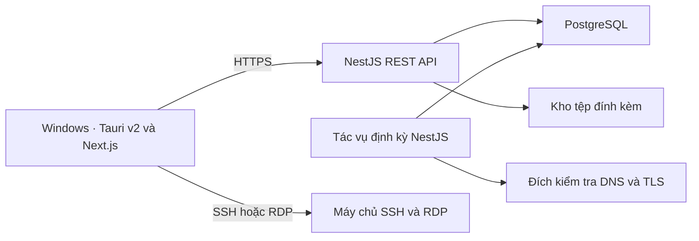

# Kiến trúc LCIT_Manager

## Tổng quan

LCIT_Manager là ứng dụng Windows quản lý danh mục hệ thống, ứng dụng và hạ tầng tập trung, thay thế quy trình cập nhật thủ công trên Google Sheets và Excel. Người dùng có thể tra cứu theo IP, tên miền, tên ứng dụng hoặc đơn vị. Kết quả hiển thị ứng dụng, máy chủ liên quan, tên miền, đơn vị chủ quản, người phụ trách và phương thức truy cập theo quyền của người dùng.

Phạm vi gồm tài khoản và phân công, danh mục ứng dụng/CSDL, máy chủ và tên miền/DNS, tài liệu đính kèm, cảnh báo gia hạn và gián đoạn, SSH/RDP, nhật ký, thông báo, nhập Excel, dashboard và xuất báo cáo Excel.

Tài liệu mô tả thiết kế đề xuất trước triển khai. Thiết kế giả định nhiều máy Windows sử dụng chung một API và một cơ sở dữ liệu. Yêu cầu nghiệp vụ lấy từ [PM_Quan ly ung dung.docx](https://chatgpt.com/library?file_id=libfile_1647d481a5908191878034883dc8d0c2&account_id=personal).

## Kiến trúc hệ thống

| Thành phần | Trách nhiệm |
| --- | --- |
| Tauri v2 và Next.js | Đóng gói giao diện từ thư mục `out`, gọi REST API lúc chạy, mở ứng dụng SSH/RDP trên Windows và hiển thị thông báo. |
| NestJS REST API | Xác thực tài khoản, phân quyền theo vai trò và phân công, quản lý danh mục, tìm kiếm, nhập/xuất Excel, cấp quyền tải tệp và ghi nhật ký. |
| PostgreSQL | Lưu dữ liệu nghiệp vụ, quan hệ, thông báo, kết quả kiểm tra và nhật ký. Dùng migration để quản lý lược đồ và transaction cho các thay đổi cần ghi đồng thời. |
| Tác vụ định kỳ | Chạy phía máy chủ, truy cập các đích kiểm tra được cấu hình và tạo cảnh báo. Bản đầu có thể dùng `@nestjs/schedule` với một tiến trình lập lịch. |
| Kho tệp đính kèm | Lưu nội dung tệp trong kho riêng tư. PostgreSQL lưu định danh, siêu dữ liệu và liên kết nghiệp vụ. API kiểm tra quyền khi tải lên hoặc tải xuống. |

### Mô hình dữ liệu

| Nhóm dữ liệu | Quan hệ và thuộc tính chính |
| --- | --- |
| Đơn vị, tài khoản, phân công | Ứng dụng có đơn vị chủ quản và người phụ trách. Tài khoản có vai trò Lãnh đạo, Quản trị hoặc Chuyên viên. Phân công xác định phạm vi hệ thống được thao tác. |
| Ứng dụng và CSDL | Lưu tên, trạng thái, hình thức dịch vụ và thông tin quản lý. Dùng bảng liên kết nhiều–nhiều giữa ứng dụng và máy chủ để biểu diễn việc triển khai trên nhiều máy hoặc dùng chung máy. |
| Máy chủ và điểm truy cập | Lưu vị trí/DC, hệ điều hành, cấu hình, ghi chú và địa chỉ nội bộ hoặc công khai/NAT. Điểm truy cập có giao thức, host và cổng. Định danh máy chủ có xét phạm vi mạng để xử lý IP nội bộ trùng nhau. |
| Tên miền, DNS và TLS | Tách tên miền đăng ký, bản ghi DNS và endpoint TLS. Liên kết tên miền hoặc bản ghi với ứng dụng. Lưu hạn gia hạn nhập tay, hạn chứng thư quan sát được và trạng thái kiểm tra theo từng nguồn. |
| Dữ liệu vận hành | Lưu tệp đính kèm, lô nhập, kết quả kiểm tra, cảnh báo và nhật ký. Nhật ký ghi người thực hiện, thời điểm, hành động, đối tượng và kết quả trong phạm vi hệ thống quan sát được. |

API kiểm tra quyền trên từng tài nguyên, gồm cả tra cứu, xuất báo cáo và truy cập SSH/RDP. Phương án ban đầu là Lãnh đạo xem báo cáo, Chuyên viên cập nhật hệ thống được phân công và Quản trị quản lý tài khoản, phân công và danh mục. Ma trận quyền chi tiết cần chốt với đơn vị sử dụng.

## Luồng dữ liệu

1. **Đăng nhập và tra cứu.** Người dùng xác thực với API. Khi nhận truy vấn, API áp dụng phạm vi được xem rồi chuẩn hóa IP/tên miền để đối chiếu chính xác và tìm theo tên ứng dụng hoặc đơn vị. API trả về các bản ghi liên quan trong phạm vi đã cấp quyền.
2. **Cập nhật danh mục và tài liệu.** API kiểm tra quyền và dữ liệu đầu vào, ghi thay đổi danh mục và nhật ký trong cùng transaction. Với tệp đính kèm, API kiểm tra loại và kích thước tệp, rồi lưu nội dung và siêu dữ liệu. Tệp tải lên dở cần được dọn để tránh bản ghi hoặc tệp mồ côi.
3. **Nhập Excel.** Người dùng tải tệp và ánh xạ cột. API chuẩn hóa, kiểm tra lỗi và tạo bản xem trước gồm dòng mới, dòng có thể trùng và dòng cần xử lý. Khi người dùng xác nhận, API kiểm tra lại xung đột, ghi dữ liệu hợp lệ theo lô và lưu kết quả. Mỗi lô có định danh để thao tác gửi lại không ghi trùng.
4. **Kiểm tra và cảnh báo.** Tác vụ định kỳ đối chiếu hạn tên miền/SSL đã nhập, đồng thời có thể kiểm tra DNS và chứng thư TLS thực tế. Cảnh báo ở các mốc **90, 30, 14 và 7 ngày**, chống lặp theo tài nguyên, loại hạn, kỳ hạn và mốc. Sau một lần chạy bị lỡ, ghi nhận mốc khẩn nhất đang áp dụng. Lỗi DNS, timeout, lỗi TLS và chứng thư hết hạn có trạng thái riêng để người vận hành biết phép kiểm nào thất bại.
5. **Kết nối SSH/RDP.** Khi người dùng bấm kết nối, API xác nhận quyền đối với điểm truy cập, trả host/cổng đã lưu và ghi yêu cầu. Tauri kiểm tra tham số rồi mở `ssh.exe` hoặc `mstsc.exe` trên máy người dùng. Máy khách thực hiện xác thực trực tiếp với máy chủ đích. Nhật ký phân biệt yêu cầu đã được cấp quyền với kết quả mở trình khách nếu ứng dụng nhận được kết quả đó.
6. **Dashboard và báo cáo.** API tổng hợp ứng dụng, máy chủ và tên miền theo phạm vi được xem. Báo cáo lọc theo đơn vị, DC hoặc hình thức dịch vụ và xuất Excel với cùng điều kiện lọc. Khi một ứng dụng có nhiều máy chủ tại một DC, chỉ tính ứng dụng đó một lần tại DC đó.

## Giới hạn kỹ thuật

| Giới hạn | Ảnh hưởng và cách xử lý |
| --- | --- |
| Next.js đóng gói dạng tĩnh | Dùng `output: 'export'` và cấu hình Tauri trỏ `frontendDist` tới `out`. SSR theo yêu cầu, Server Actions và route động cần máy chủ Next.js nằm ngoài khả năng của bản đóng gói này. Giao diện tải dữ liệu nghiệp vụ qua NestJS lúc chạy. |
| Phụ thuộc mạng và vị trí triển khai | Tra cứu và cập nhật cần kết nối API. Thiết kế hiện tại giả định làm việc trực tuyến. Máy chạy tác vụ phải truy cập được DNS và endpoint cần theo dõi. Máy Windows người dùng phải có đường mạng hoặc VPN đến đích SSH/RDP. |
| Hạn tên miền và SSL có nguồn khác nhau | Hạn nhập tay hỗ trợ cảnh báo nghiệp vụ ngay từ đầu. Có thể bổ sung RDAP cho tên miền gTLD. Nguồn tích hợp tự động cho `.vn` cần xác minh với VNNIC hoặc nhà đăng ký. TLS chỉ cho biết chứng thư endpoint trình ra tại thời điểm kiểm tra. |
| Phạm vi kiểm tra dịch vụ | DNS phân giải hoặc TLS bắt tay thành công chỉ chứng minh bước kiểm tra tương ứng. Đánh giá ứng dụng hoạt động đầy đủ cần có endpoint sức khỏe và tiêu chí riêng. Các đích kiểm tra tự động cần được giới hạn theo cấu hình mạng được phê duyệt. |
| Nhật ký SSH/RDP và thông báo Windows | Mở trình khách ngoài chỉ cho phép ghi yêu cầu và kết quả khởi chạy quan sát được. Xác nhận đăng nhập hoặc ghi nội dung phiên cần tích hợp máy chủ đích hoặc gateway. Thông báo vẫn được lưu ở máy chủ khi ứng dụng đóng. Hiển thị ở khay Windows cần ứng dụng hoặc tiến trình nền đang chạy. |
| Nhập Excel và chất lượng dữ liệu | Cần tệp mẫu để chốt ánh xạ cột, cách đọc ngày và tiêu chí nhận diện bản ghi trùng. Trùng tên ứng dụng hoặc trùng IP nội bộ là tín hiệu cần đối chiếu thêm trước khi gộp. |
| Vận hành và build Windows | Build Tauri trên Windows cần Rust, MSVC Build Tools và WebView2 theo hướng dẫn của Tauri. Docker là một phương án chạy API/PostgreSQL trong phát triển hoặc triển khai. Sao lưu cần bao phủ PostgreSQL và kho tệp, kèm kiểm thử khôi phục. Khi chạy nhiều tiến trình lịch, cần cơ chế khóa hoặc hàng đợi để tránh chạy cùng một tác vụ đồng thời. |

Tài liệu kỹ thuật tham chiếu

- [Tauri v2 với Next.js](https://v2.tauri.app/start/frontend/nextjs/) · [Điều kiện build Tauri](https://v2.tauri.app/start/prerequisites/)
- [Next.js Static Exports](https://nextjs.org/docs/app/guides/static-exports) · [NestJS Task Scheduling](https://docs.nestjs.com/techniques/task-scheduling)
- [ICANN về RDAP cho gTLD](https://www.icann.org/en/announcements/details/icann-update-launching-rdap-sunsetting-whois-27-01-2025-en) · [VNNIC về tra cứu tên miền .vn](https://www.vnnic.vn/vi/ten-mien-vn/ho-tro/cau-hoi-thuong-gap/cau-hoi-ve-dang-ky-ten-mien)
- [Microsoft OpenSSH](https://learn.microsoft.com/en-us/windows-server/administration/openssh/openssh-overview) · [Microsoft Remote Desktop Connection](https://learn.microsoft.com/vi-vn/Windows-server/administration/windows-commands/mstsc)
